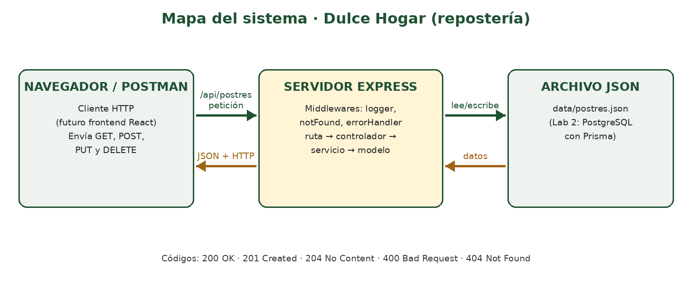

# Propuesta del emprendimiento · Grupo GXX

> Actividad 1.

| Campo | Respuesta |
|---|---|
| Nombre del emprendimiento | Repostería casera |
| Problema que resuelve | Las reposterías pequeñas llevan sus postres, precios y stock en cuadernos o chats de mensajería, y se pierden pedidos y el control del inventario. |
| Usuarios (quién lo usa) | Dueño de la repostería (administra el catálogo) y sus clientes (consultan postres y hacen pedidos). |
| 3 funciones principales | 1. Registrar y consultar los postres del catálogo.   2. Controlar el stock disponible de cada postre.   3. Registrar los pedidos de los clientes. |

## Mapa frontend–backend

Se envía peticiones HTTP a `/api/postres`; el servidor Express las procesa en capas (ruta → controlador → servicio → modelo), lee o escribe el archivo JSON y responde con JSON y un código de estado.

## Entidades (3) y atributos principales

| Entidad | Atributos | ¿Se relaciona con…? |
|---|---|---|
| Postre (entidad del Lab 1) | id, nombre, precio, stock, categoria | Un pedido incluye uno o varios postres |
| Cliente | id, nombre, telefono, correo | Un cliente hace varios pedidos |
| Pedido | id, fecha, total, estado | Pertenece a un cliente e incluye postres |

## 3 endpoints iniciales

| Verbo | Ruta | Código de estado |
|---|---|---|
| GET | /api/postres | 200 |
| POST | /api/postres | 201 (400 si los datos no son válidos) |
| DELETE | /api/postres/:id | 204 (404 si no existe) |
